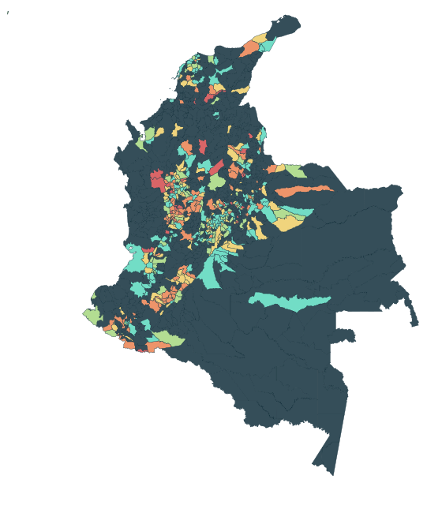

```{=html}
<div class="water-home">
<section class="atlas-hero" aria-labelledby="hero-title">
  <div class="hero-copy">
    <p class="eyebrow"><span class="live-dot"></span> A Colombian water atlas · 2010–2023</p>
    <h1 id="hero-title">One country.<br>Many realities.<br><em>Every drop matters.</em></h1>
    <p class="hero-deck">A closer look at drinking-water safety, the urban–rural divide, and the places where the evidence is still missing.</p>
    <div class="hero-actions"><a class="button-primary" href="explore.html">Explore the evidence <span aria-hidden="true">↗</span></a><a class="text-link" href="report.html">Read the report <span aria-hidden="true">→</span></a></div>
    <div class="hero-footnote">Municipal water safety & infant mortality<br><strong>Descriptive evidence. Local context. Open data.</strong></div>
  </div>
  <figure class="map-panel">
    <div class="map-heading"><span>FIELD NOTES / 01</span><span>COLOMBIA</span></div>
    
    <figcaption><strong>Water risk has a geography.</strong><span>Rural · 2023 · IRCA (utility-supplied, INS open data)</span><div class="map-legend"><span><i style="background:#72ddc6"></i>No risk</span><span><i style="background:#b3dd92"></i>Low</span><span><i style="background:#f0d47d"></i>Medium</span><span><i style="background:#ed946a"></i>High</span><span><i style="background:#d96567"></i>Unfit</span><span><i style="background:#354e59"></i>Missing</span></div><small>Municipal boundaries: DANE. Missing reports are not evidence of safe water.</small></figcaption>
  </figure>
</section>
<section class="scope-strip" aria-label="Dataset scope">
 <div><strong>14<span>years</span></strong><p>2010–2023 in the source table</p></div>
 <div><strong>1,122<span>territorial codes</span></strong><p>Municipalities, an island & non-municipalised areas</p></div>
 <div><strong>2<span>perspectives</span></strong><p>Urban and rural zones, side by side</p></div>
 <div class="scope-note">The source table spans 2010–2023.<br><b>Profile analysis focuses on 2016–2023.</b></div>
</section>
<section class="evidence-section" aria-labelledby="evidence-title">
 <div class="section-intro"><p class="eyebrow">01 / Read between the rows</p><h2 id="evidence-title">The gaps are<br>part of the story.</h2><p>A map can only show what was reported. Rural water-quality observations are missing much more often than urban ones.</p><a class="text-link dark-link" href="explore.html">See the data coverage <span aria-hidden="true">→</span></a></div>
 <div class="coverage-panel"><p class="eyebrow">Reporting coverage · all source years</p><h3>How much can we see?</h3><p>Share of municipality × zone × year rows with a reported value for IRCA (utility-supplied, INS open data), 2010–2023.</p><div class="coverage-row"><div><strong>Urban</strong><span>85.5%</span></div><div class="track"><span style="width:85.5%"></span></div></div><div class="coverage-row rural"><div><strong>Rural</strong><span>47.1%</span></div><div class="track"><span style="width:47.1%"></span></div></div><p class="coverage-note">Source: data/README.md, computed from the local CSV. The rural decline in the risk score in 2020 may reflect which systems were sampled.</p></div>
</section>
<section class="pathways" aria-labelledby="pathways-title"><div class="section-heading"><div><p class="eyebrow">02 / Choose your lens</p><h2 id="pathways-title">Follow the questions.</h2></div><p>From the national picture<br>to the detail of a single place.</p></div>
<div class="pathway-grid">
<a class="path-card" href="dashboard.html"><span class="card-number">01 <span>↗</span></span><h3>See the patterns.</h3><p>Bring water safety and municipal context into view with the interactive dashboard.</p><span class="card-link">Open dashboard →</span></a>
<a class="path-card" href="clusters.html"><span class="card-number">02 <span>↗</span></span><h3>Meet the profiles.</h3><p>Compare places grouped by water, sanitation and context. Outcomes describe the groups afterwards.</p><span class="card-link">Explore clusters →</span></a>
<a class="path-card feature-card" href="visuals.html"><span class="card-number">03 <span>↗</span></span><h3>Get closer<br>to Tunja.</h3><p>Take a local view through the Boyacá and Tunja visual exploration.</p><span class="card-link">Visit the local view →</span></a>
</div></section>
<section class="reading-room"><div><p class="eyebrow">03 / Go deeper</p><h2>Evidence worth<br>reading carefully.</h2></div><div class="reading-links"><a href="posts/four-kinds.html"><span><small>THE STORY</small>Four kinds of municipal zone</span><b aria-hidden="true">↗</b></a><a href="report.html"><span><small>THE ANALYSIS</small>Methods, findings & limitations</span><b aria-hidden="true">↗</b></a><a href="slides.html"><span><small>THE PRESENTATION</small>Walk through the research</span><b aria-hidden="true">↗</b></a></div></section>
<aside class="research-note"><span class="eyebrow">A note on interpretation</span><p>These comparisons are descriptive and <strong>do not establish effects of water quality</strong> on infant mortality or other outcomes. Poverty, healthcare access, geography, municipal capacity and reporting differences may confound comparisons. Infant mortality changes method in 2017 and is volatile in small municipalities.</p><a href="report.html">Read the limitations →</a></aside>
<footer class="atlas-footer"><span>COLOMBIA / WATER & PLACE</span><span>Built from the files in data/ · 2010–2023</span><a href="#hero-title">Back to top ↑</a></footer>
</div>
```
